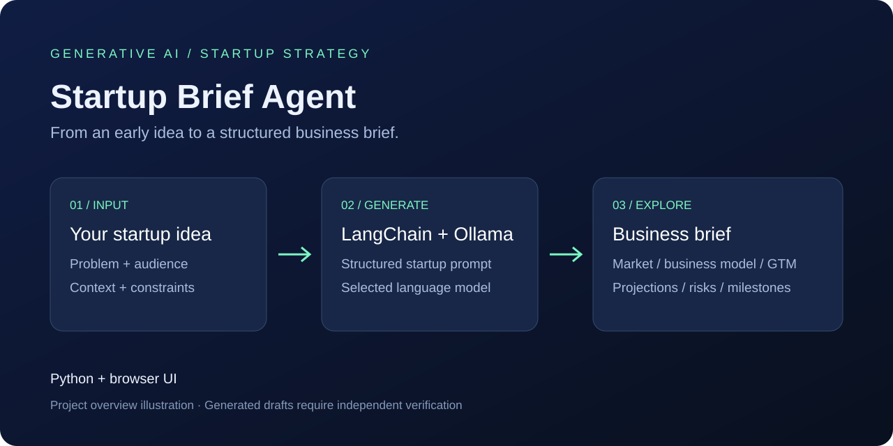
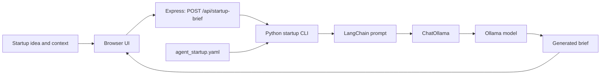

# GenAI Startup Brief Agent



**Turn a startup idea into a structured business brief with LangChain and Ollama.**

A Python generative AI prototype with a browser interface and command-line entry points. Enter an idea, add context, select an Ollama model, and request a brief covering customers, competition, monetization, go-to-market strategy, risks, and financial assumptions.

**Project type:** Generative AI / LLM application  
**Stack:** Python · LangChain · Ollama · Node.js · Express · HTML/CSS/JavaScript

## Features

- Startup brief generation from a single idea and optional additional details.
- A prompt requesting 15 sections, including a Business Model Canvas and three-year financial projections with sensitivity analysis.
- Browser UI backed by an Express endpoint that launches the Python CLI.
- Dedicated startup CLI plus general single-prompt and interactive chat entry points.
- Model choices exposed by the CLIs: `llama3.2:latest`, `minimax-m2.5:cloud`, and `kimi-k2.5:cloud`. Availability depends on your Ollama instance and account.
- Deterministic stub output when the LangChain prompt or Ollama integration dependencies are missing.
- Model availability validation and configurable connection retries.

## Project visual

The image above is a project overview illustration, not a screenshot or a sample generated result.

## Architecture



`src/startup_prompt.py` loads the prompt from `agent_startup.yaml`, with a fallback if the file or marker is missing. `src/agent.py` composes a system/human prompt with `ChatOllama` at temperature zero. The UI server invokes `src/startup_agent_cli.py` and returns its stdout to the browser.

Despite the historical agent name, the current implementation is a prompt-to-model runnable; it does not implement autonomous tool calling, web research, retrieval, or a multi-agent workflow.

## Getting started

### Prerequisites

- Python 3.10 or later.
- Node.js and npm for the browser UI.
- Ollama running with a model available under its exact tag.
- The existing UI launcher expects a Windows virtual environment at `.venv/Scripts/python.exe`.

### Install on Windows (PowerShell)

```powershell
git clone https://github.com/vams2krish/GenAI-Startup-Brief-Agent.git
cd GenAI-Startup-Brief-Agent
python -m venv .venv
.\.venv\Scripts\Activate.ps1
python -m pip install -r requirements.txt
python -m pip install -r test_requirements.txt
npm --prefix ui ci
ollama pull llama3.2:latest
```

Ensure Ollama is running before generation. Run `ollama serve` in a separate terminal if it is not already running as an application/service.

### Configuration

```powershell
Copy-Item .env.example .env
```

| Variable | Default | Purpose |
| --- | --- | --- |
| `OLLAMA_HOST` | `http://localhost:11434` | Ollama endpoint; used by validation and the Ollama client environment. |
| `OLLAMA_MODEL_LIST_RETRIES` | `5` | Connection attempts during model validation. |
| `OLLAMA_MODEL_LIST_RETRY_SLEEP_SECONDS` | `1` | Delay between validation attempts. |
| `SKIP_OLLAMA_MODEL_VALIDATION` | unset | Set to `1` to bypass the availability check; inference still requires Ollama. |
| `PORT` | `3000` | Express server port; set it in the shell that starts Node. |

The Python CLIs load `.env`. The Node server reads its process environment. An OpenAI API key is not used by the current implementation. Keep local configuration and secrets out of Git.

### Browser interface

Start from the **repository root** so the server resolves the Python executable and script correctly:

```powershell
node ui/server.js
```

Open [localhost:3000](http://localhost:3000), enter your startup idea and any extra context, choose a model, and submit the form.

### Startup brief CLI

```powershell
python src/startup_agent_cli.py --idea "A scheduling assistant for independent fitness coaches" --model llama3.2:latest
```

### General chat CLI

```powershell
python src/agent_cli.py --prompt "Explain product-market fit" --model llama3.2:latest
python src/agent_cli.py --interactive --model llama3.2:latest
```

Type `exit` or `quit` to end interactive mode. Exchanges are accumulated locally but are not included in subsequent model prompts.

## Brief contents

The prompt requests executive summary; startup idea; problem statement; target customers and personas; market sizing and trends; competition; differentiation; product and solution; nine-block Business Model Canvas; monetization; go-to-market strategy; metrics and milestones; three-year financial projections and sensitivity; risks and mitigations; and exit strategies.

These are model-generated drafts. There is no live source retrieval or numerical validation, so market claims, competitor details, and financial projections need independent verification.

## Repository layout

```text
.
├── README.md
├── .env.example
├── .gitignore
├── agent_startup.yaml       # Editable business brief prompt
├── requirements.txt        # Python runtime dependencies
├── test_requirements.txt   # Test dependencies
├── pyproject.toml          # Python project metadata
├── conftest.py
├── docs/project-overview.svg
├── src/
│   ├── agent.py            # Ollama validation and runnable factory
│   ├── agent_cli.py        # General chat CLI
│   ├── startup_agent_cli.py
│   ├── startup_prompt.py   # Prompt loading and rendering
│   ├── logging_config.py   # Optional logging configuration helper
│   └── tests/test_agent.py
└── ui/
    ├── index.html          # Browser interface
    ├── server.js           # Express and Python process bridge
    ├── package.json
    ├── package-lock.json
    └── README_UI.md
```

## Validation

```powershell
python -m pytest -q
node --check ui/server.js
```

The existing unit test checks that the agent can be constructed while model validation is patched out. It does not test live inference, response quality, or the browser-to-model flow.

## Current limitations and troubleshooting

- **Model missing / connection failure:** check `ollama list`, pull the exact model tag, and verify `OLLAMA_HOST`.
- **`[stub]` output:** required LangChain/Ollama dependencies were not imported; install the runtime requirements in the interpreter you are using.
- **UI launch directory:** use `node ui/server.js` from the root. Running `npm start` inside `ui` makes the current server resolve the wrong Python and script paths.
- **Platform support:** the Python code can run on other platforms, but the UI process launcher currently hardcodes the Windows virtual environment layout and has no implemented system-Python fallback.
- **Response handling:** the interactive chat path assumes a dictionary result even though the full runnable returns an AI message; it needs normalization for reliable interactive use. The startup CLI prints the raw message representation rather than extracting only its text.
- **Server hardening:** authentication, request timeouts, robust subprocess error handling, and deployment controls are not implemented. Use as a local development prototype.
- **Logging:** the CLIs use Loguru; file rotation is available in `configure_logging()` but the current entry points do not call that helper.
- Dependencies use lower bounds rather than a fully pinned Python lockfile.

## Customization

Edit `agent_startup.yaml` to change the requested brief sections. Keep the `startup_brainstorm_prompt: |` field and `{idea}` placeholder. Add model options consistently in the CLI argument choices and browser selector. Extend `build_agent()` to introduce additional prompt behavior or an actual tool-calling runtime.

## License

No license has been selected for this repository. Add a license before distributing it under specific reuse terms.
