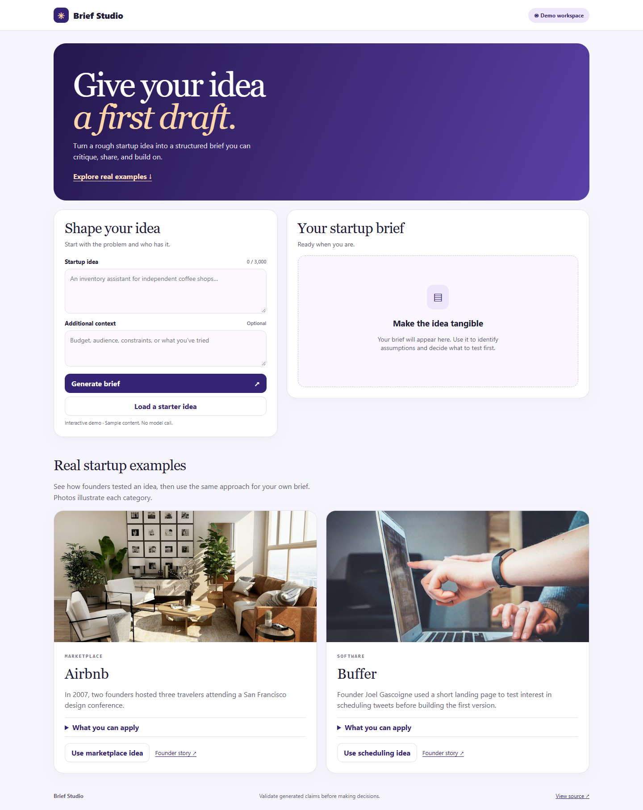

# GenAI Startup Brief Agent · Brief Studio

**[Open live web research](https://genai-startup-brief-agent.vercel.app/)**

Turn an early startup idea into a structured planning brief. The hosted app searches Tavily for evidence relevant to your idea and adds a linked source list. Local Ollama mode creates a separate model-generated draft.



## Features

- Enter an idea and optional audience, budget, or launch constraints, or prefill the form with an example.
- Generate a brief covering customers, competition, business model, go-to-market, financial assumptions, and risks. The local prompt requests 15 sections.
- Copy the brief or download Markdown. A failed request keeps the previous brief available.
- Generate a brief from the terminal or use the general chat CLI.

## Real examples and screenshots

Explore [Airbnb’s first hosted stays](https://news.airbnb.com/airbnb-celebrates-half-a-billion-guest-arrivals) and [Buffer’s landing-page test](https://buffer.com/resources/idea-to-paying-customers-in-7-weeks-how-we-did-it/). Each case includes an experiment you can adapt and a starter idea you can load into the form.

[Desktop gallery](docs/screenshots/07-real-examples.png) · [Loaded example brief](docs/screenshots/08-loaded-example.png) · [Mobile gallery](docs/screenshots/09-mobile-examples.png)

Illustrative photography from Unsplash: [living room](https://images.unsplash.com/photo-1600210492486-724fe5c67fb0) and [laptop workspace](https://images.unsplash.com/photo-1516321318423-f06f85e504b3).

## Run with local Ollama

Prerequisites: Python 3.10+, Node.js 22+, npm, and a running Ollama instance. From the repository root on Windows:

```powershell
python -m venv .venv
.\.venv\Scripts\python.exe -m pip install -r requirements.txt -r test_requirements.txt
npm --prefix ui ci
ollama pull llama3.2:latest
npm --prefix ui start
```

On macOS or Linux, use `.venv/bin/python` instead. Open [127.0.0.1:3000](http://127.0.0.1:3000). Start `ollama serve` if Ollama is not running. Pull the exact model tag you intend to use. Cloud model tags require Ollama account access and can send prompts off-device.

| Setting | Purpose |
| --- | --- |
| `OLLAMA_HOST` | Model endpoint; defaults to `http://localhost:11434`. |
| `OLLAMA_MODEL_LIST_RETRIES` | Availability attempts; default 5. |
| `OLLAMA_MODEL_LIST_RETRY_SLEEP_SECONDS` | Delay between attempts; default 1 second. |
| `SKIP_OLLAMA_MODEL_VALIDATION` | Set to 1 to skip model availability validation. |
| `PORT` | Local web port; default 3000. |
| `PYTHON_EXEC` | Override the Python interpreter used by Express. |

Use `.env.example` for Python settings. Set Node variables in the shell that starts the server.

## CLI

With the environment active:

```powershell
python src/startup_agent_cli.py --idea "A scheduling assistant for independent fitness coaches"
python src/agent_cli.py --prompt "Explain product-market fit"
python src/agent_cli.py --interactive
```

Interactive chat includes the latest six exchanges. Type `exit` or `quit` to end.

## Architecture and tests

Set the optional TAVILY_API_KEY server environment variable in Vercel to use your Tavily account quota. Shared access is used by default. Vercel serves the interface from `ui/public`. Locally, the loopback Express server validates the request and invokes the Python CLI with a timeout. The CLI renders `agent_startup.yaml`, calls Ollama through LangChain, and prints response text. The browser displays output as text and exports Markdown. Market claims and financial assumptions need independent verification.

See the [UI documentation](ui/README_UI.md) for design tokens. Run `python -m pytest -q` and `node --check ui/server.js` for local checks. No license has been selected.
